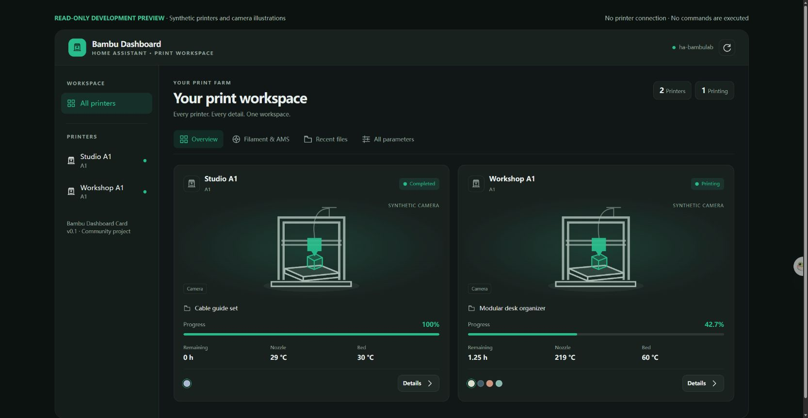

# Bambu Dashboard Card

A complete multi-printer dashboard for Home Assistant, built with TypeScript and Lit and powered by the existing [ha-bambulab](https://github.com/greghesp/ha-bambulab) integration.

**Development status:** initial implementation. No stable release yet. Real printer controls must be verified on the target hardware before treating a release as production ready.



The screenshot uses explicitly labeled synthetic devices and camera illustrations. It does not expose a real installation.

The deliverable includes both the custom frontend component and a complete dashboard configuration. Device discovery is dynamic; printer IDs, addresses, credentials, and a fixed printer count are not embedded in the source.

## Implemented initial version

- Multi-printer overview and a responsive masonry detail workspace with independent camera, job, control, parameter and filament cards.
- Complete entity and attribute explorer.
- Camera, light, speed, pause, resume, stop, and sliced-project printing.
- AMS and external-spool visualization based on registered devices.
- Cached project browser, downloads, metadata checks, and reprinting through the integration's authenticated APIs.
- Responsive layout, Home Assistant themes, and a visual configuration editor.
- Per-printer completion reminders backed by native HA automations, including Android alarm-stream alerts and standard notification destinations.

## Development

```sh
npm ci
npm run test
npm run typecheck
npm run build
```

The build produces `dist/bambu-dashboard-card.js`. Runtime data and commands use the Home Assistant session. There is no separate MQTT client or service to deploy.

Run `npm run dev` for a labeled, read-only development preview with synthetic data. Commands are rejected in this preview; it cannot connect to a printer.

See the [installation guide](docs/installation.md) and [complete dashboard configuration](dashboards/bambu-dashboard.yaml). The built JavaScript is committed so a HACS custom repository can install the default branch during development.

Completion reminders are configured in a printer's detail view by an HA administrator. Select a phone, choose a reminder style, enable it and save. **Test phone reminder** immediately sends one message using the current choices, without saving or enabling the automation. HA runs the reminder after the dashboard closes. Android offers alarm-style notifications and alarm speech; both use alarm audio while ordinary notification settings remain unchanged. They do not create a Clock-app alarm or continuously repeat. See [phone setup and delivery limits](docs/installation.md#completion-reminders).

## Scope and compatibility

Requires Home Assistant and ha-bambulab. Initial hardware validation targets A1 printers and AMS Lite. Support for additional models is derived from their registered entities and capabilities, with model-specific behavior documented as it is tested.

The integration's `print_history` endpoint lists **cached project files**, not a complete record of completed prints. The UI must preserve that distinction. Historical cloud task storage is outside the initial release.

## License

MIT. This is a community project, not an official Bambu Lab product.
